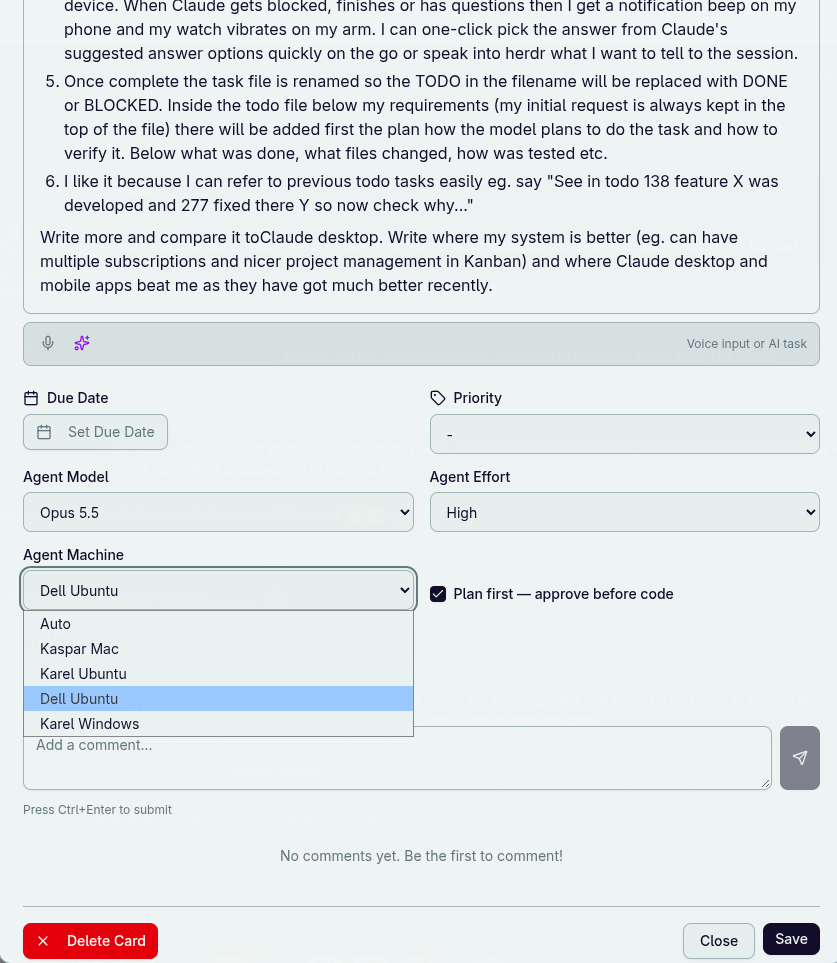
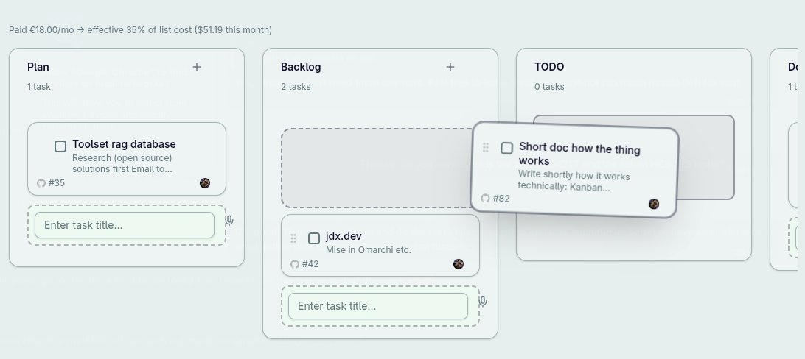
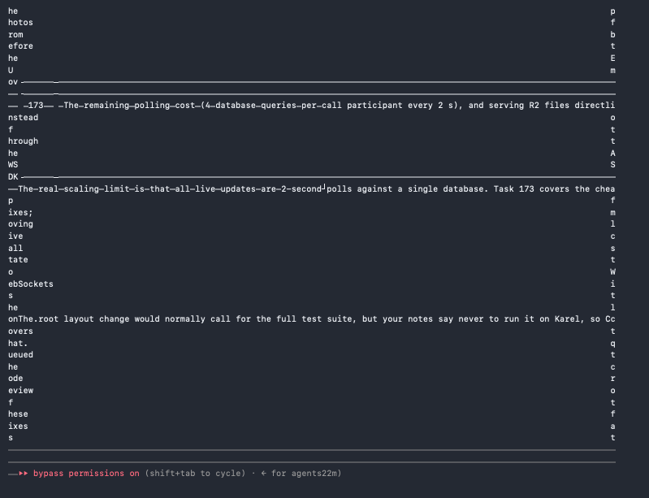

# I run Claude Code from a Kanban board on four machines

Most of my code is now written by Claude Code sessions that I
start by dragging a card. I don't open a terminal and I don't type a prompt into a chat.
I write the card, set a model, and move it to TODO. A machine somewhere in the house
picks it up, and my watch buzzes when the session needs me.

Here's how it works and where it's still worse than just using the Claude apps.

## The card

Every task starts as a card on my own Kanban board. I type it or dictate it with the
microphone button. Under the description there are three dropdowns: model, effort and
the machine that should run it. There's also a "Plan first" checkbox for when I want to
approve the plan before any code gets written.

Any of the three can stay on Auto. With Auto model, a cheap Haiku call reads the task and
picks the model family. With Auto machine, whichever runner is free claims the card
first.

When I save the card, the server creates a GitHub issue and pushes a markdown file to the
repo, `doc/todo/082-shortOverviewDocHow.md`. The number is the issue number. My
original text goes at the top of that file and nobody is allowed to change it later.

## Moving it to TODO

Dragging the card into the TODO column renames the file to
`082-shortOverviewDocHow-TODO.md` and pushes again. That rename is the whole queue. There
is no job table anywhere, just filenames in git.

The line at the top of the board says what all this costs: €18 a month, which works out
at 35% of what the same tokens would cost at API prices ($51.19 so far this month).

## Four machines, four subscriptions

A small Node daemon runs on each of four machines: my Mac, two Ubuntu boxes (Dell and
Karel), and a Windows PC under WSL. Every 20 seconds each one pulls the repos and
looks for `-TODO.md` files addressed to it. Each machine is logged in to a different €18
Claude subscription. One is mine. The other three belong to friends who aren't
developers and use less than half of their weekly allowance, so their unused tokens go
into my queue. (I still need to check how that fits Anthropic's terms, because consumer
plans are meant for the person who pays for them.)

When a runner takes a task it opens a tab in herdr and starts `claude` with the model and
effort from the card, running `/todo 82`. If a machine hits its usage limit it just waits
until the reset time, and the other three keep going.

## Watching from the phone

herdr serves those terminal panes to a web page, so I can watch any session live from my
phone. When Claude finishes, gets blocked or asks a question, Pushbullet sends a
notification. The phone beeps and the watch vibrates. Most questions come with suggested
answers, so I tap one on the go, or I dictate a reply.

It isn't always pretty. A wide terminal squeezed onto a phone screen sometimes ends up
like this:

## When it's done

The session writes its plan into the task file, does the work, and adds a Results section
listing what changed, which files and how it was tested. Then it renames the file to
`-DONE.md`, or `-BLOCKED.md` if a person has to finish something, commits with `(#82)`
and pushes. The runner moves the card to Review and posts the result and the cost on the
card and the issue.

The part I like most turned out to be the folder of finished files. It's a numbered,
searchable history of every request and what came of it. I can tell a new session "in
todo 138 we built feature X and 277 fixed Y in it, now find out why Z" and it reads both
files.

## Where the Claude apps are better

The Claude desktop and mobile apps have got much better recently, and in several places
they beat my setup.

Mine took dozens of tasks just to keep running: systemd and launchd units, herdr servers,
notification tokens, first-run dialogs on every new machine, and git races between
runners. The apps need none of that. Their UI shows diffs, files and images properly,
while I get a terminal on a phone screen. Remote Control and notifications work
without me wiring them up. Cloud sessions run with my laptop closed. Code review,
scheduled routines and browser use keep getting better without me maintaining anything.

What I still get from mine is the queue. Four accounts feed one board, ten cards can wait
their turn overnight, every task has its own model and machine, and the whole history
sits in git next to the code. The apps are built around one conversation at a time. My
board is built around a backlog.
